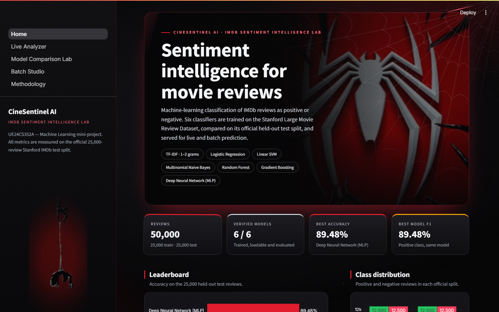
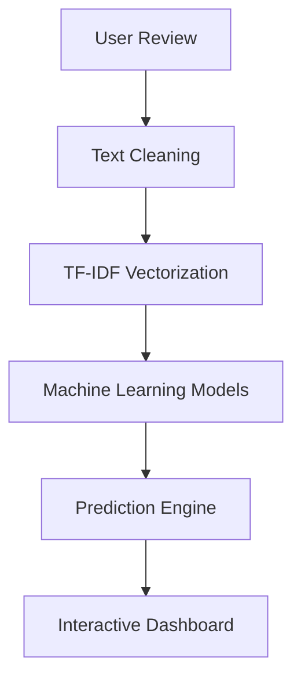
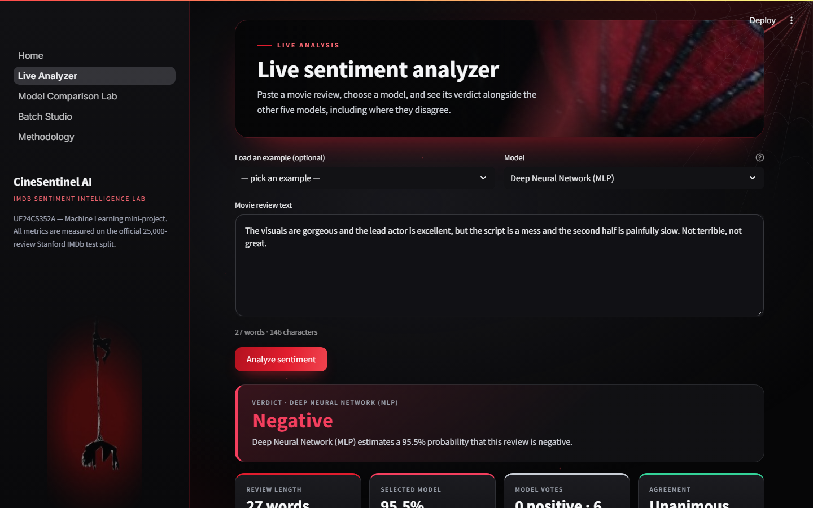
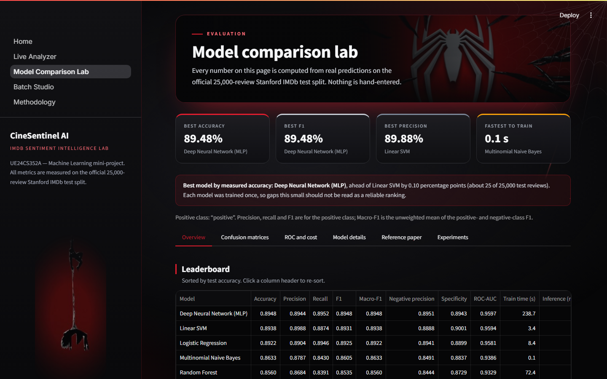
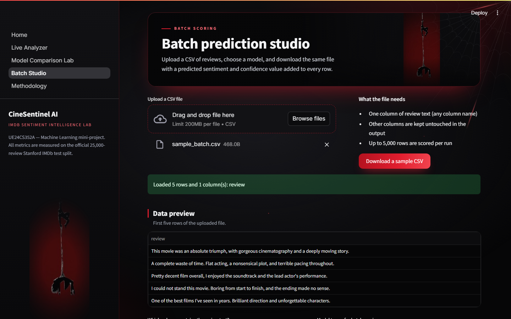
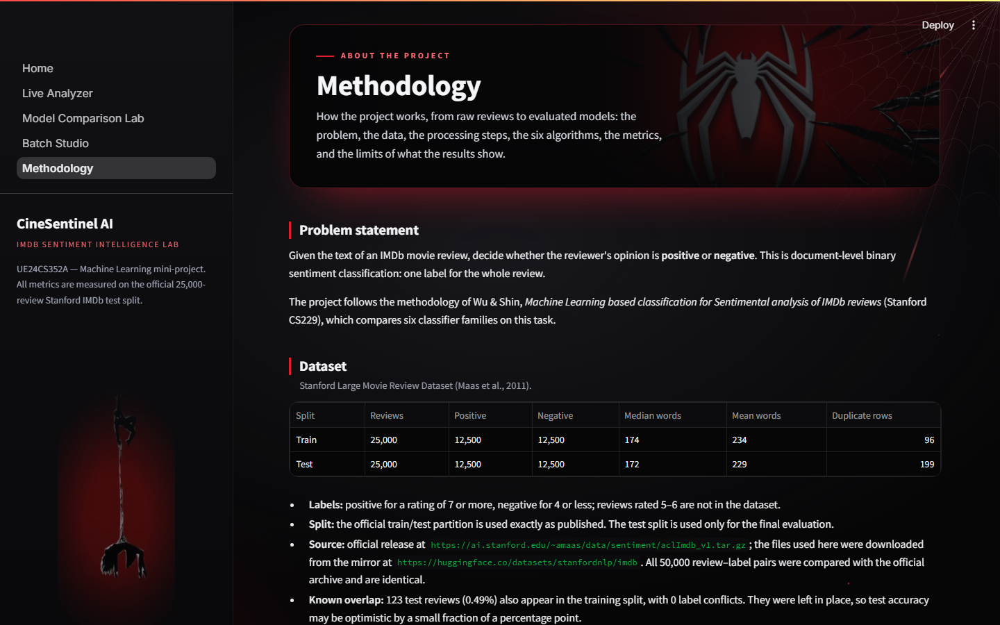

<div align="center">

# 🎬 CineSentinel AI

### IMDb Sentiment Intelligence Platform powered by Machine Learning

Six machine-learning classifiers trained on 25,000 IMDb reviews, evaluated on
25,000 more, and served through an interactive dashboard for live prediction,
model comparison and batch scoring.

[](https://cinesentinel-raviteja.streamlit.app/)




</div>

---

## Overview

**The problem.** Given the text of a movie review, decide whether the
reviewer's opinion is positive or negative. This is document-level binary
sentiment classification.

**Why it matters.** Reviews are written faster than anyone can read them.
Automatic sentiment analysis turns free text into a signal that can be
counted and tracked, which is useful for studios, streaming platforms and
recommendation systems, and it is a standard benchmark task for comparing
text classifiers.

**What this application provides.** CineSentinel AI trains six classical
classifiers on identical TF-IDF features from the Stanford Large Movie
Review Dataset, measures them on the dataset's official test split, and
exposes them through a five-page Streamlit dashboard. The method follows the
reference paper by Wu & Shin (Stanford CS229), included in the repository as
[`ML_Project_mini_REFERENCE.pdf`](ML_Project_mini_REFERENCE.pdf).

> Course mini-project for **UE24CS352A — Machine Learning**.

## Features

| | Feature | Description |
|---|---|---|
| ✓ | **Real-time sentiment prediction** | Type or paste a review and get a positive / negative verdict with a confidence value |
| ✓ | **Six-model comparison** | Every review is scored by all six models, with a notice when they disagree |
| ✓ | **Interactive Streamlit dashboard** | Home, Live Sentiment Analyzer, Model Comparison Lab, Batch Prediction Studio, Methodology |
| ✓ | **Batch CSV prediction** | Upload a CSV of up to 5,000 rows, pick the text column and model, download the results |
| ✓ | **Performance visualization** | Confusion matrices, ROC curves, metric charts and training-cost comparison |
| ✓ | **Model evaluation reports** | Metrics stored as JSON / CSV in `reports/metrics/` and read directly by the dashboard |

## System Architecture



Training and evaluation run offline and save the models to `models/` and the
metrics to `reports/metrics/`. The dashboard loads those files at start-up;
nothing is trained at run time.

## Machine Learning Pipeline

| Stage | What happens |
|---|---|
| **Dataset** | Stanford Large Movie Review Dataset (Maas et al., 2011): 25,000 training and 25,000 test reviews, each split balanced at 12,500 positive and 12,500 negative. The official split is used unchanged |
| **Preprocessing** | Strip HTML → lowercase → remove punctuation and digits → remove English stop words → lemmatize (NLTK WordNet) |
| **Feature extraction** | TF-IDF over unigrams and bigrams, 50,000 terms, `min_df = 5`, `max_df = 0.9`, sublinear term frequency. Fitted on the training split only |
| **Training** | Six classifiers on the same feature matrix, random seed 42. Model selection uses training data only (cross-validation or a held-out part of the training split) |
| **Evaluation** | Accuracy, precision, recall, F1, ROC-AUC and confusion matrices on the 25,000-review test split |

## Models Implemented

| Model | Purpose | Performance (Accuracy / F1) |
|---|---|---|
| **MLP Neural Network** | Feed-forward network with five hidden layers (30, 30, 20, 10, 10) | 89.48% / 0.8948 |
| **Linear SVM** | Maximum-margin linear classifier, calibrated for probabilities (C = 0.25) | 89.38% / 0.8931 |
| **Logistic Regression** | Linear probabilistic classifier with interpretable word weights (C = 1.0) | 89.22% / 0.8925 |
| **Multinomial Naive Bayes** | Fast probabilistic baseline (alpha = 1) | 86.33% / 0.8605 |
| **Random Forest** | Bagged ensemble of 100 decision trees | 85.60% / 0.8535 |
| **Gradient Boosting** | Boosted ensemble of 270 shallow trees | 84.41% / 0.8482 |

Hyperparameters follow the reference paper, except the Gradient Boosting
tree count, which was selected on a validation split of the training data.

## Application Screenshots

<table>
  <tr>
    <td width="50%" align="center">
      <br>
      <b>Dashboard</b><br>
      <sub>Key figures, leaderboard and dataset summary</sub>
    </td>
    <td width="50%" align="center">
      <br>
      <b>Live Sentiment Analyzer</b><br>
      <sub>Single-review prediction across all six models</sub>
    </td>
  </tr>
  <tr>
    <td width="50%" align="center">
      <br>
      <b>Model Comparison Lab</b><br>
      <sub>Metrics, confusion matrices and ROC curves</sub>
    </td>
    <td width="50%" align="center">
      <br>
      <b>Batch Prediction Studio</b><br>
      <sub>CSV upload, scoring and download</sub>
    </td>
  </tr>
  <tr>
    <td colspan="2" align="center">
      <br>
      <b>Methodology</b><br>
      <sub>Dataset, preprocessing, algorithms, metrics and limitations</sub>
    </td>
  </tr>
</table>

## Technology Stack

| Layer | Technology | Version |
|---|---|---|
| Language | Python | 3.11 |
| Data handling | Pandas | 2.2.3 |
| Numerical computing | NumPy | 2.1.3 |
| Machine learning | Scikit-learn | 1.5.2 |
| Text processing | NLTK | 3.9.1 |
| Dashboard | Streamlit | 1.39.0 |
| Visualization | Plotly | 5.24.1 |
| Testing | Pytest | 8.3.3 |

Runs on a standard laptop. No GPU or paid API is required.

## Project Structure

```
CineSentinel-AI/
├── app/                    # Streamlit dashboard
│   ├── Home.py             #   entry point
│   └── pages/              #   Live Analyzer, Comparison Lab, Batch Studio, Methodology
├── src/cinesentinel/       # ML package: preprocessing, features, training,
│                           #   evaluation, prediction
├── models/                 # Trained classifiers and the TF-IDF vectorizer
├── reports/metrics/        # Evaluation results (JSON / CSV)
├── experiments/            # Gradient Boosting and feature-representation studies
├── scripts/                # Dataset download / build and report generation
├── tests/                  # Pytest suite
├── submission/             # Report, presentation and screenshots
├── docs/                   # Requirements traceability and presentation outline
└── requirements.txt
```

## Installation

Requires **Python 3.11**. The saved models depend on the pinned package
versions in `requirements.txt`.

```bash
git clone https://github.com/raviteja2028tech/CineSentinel-AI.git
cd CineSentinel-AI
pip install -r requirements.txt
streamlit run app/Home.py
```

Then open <http://localhost:8501>.

- The trained models are in the repository, so no dataset download or
  training is needed to run the app.
- The first run downloads the NLTK word lists (about 40 MB) and needs an
  internet connection once.
- A virtual environment is recommended: `python -m venv venv`, then
  `venv\Scripts\activate` (Windows) or `source venv/bin/activate`
  (macOS / Linux) before `pip install`.

<details>
<summary><b>Run the tests or retrain the models</b></summary>

```bash
# Tests
pytest

# Retrain and re-evaluate (downloads the dataset first)
python scripts/download_data.py
python scripts/build_dataset.py
# with src on PYTHONPATH:
python -m cinesentinel.train --force
python -m cinesentinel.evaluate
```

</details>

## Results

Measured on the official 25,000-review test split. Precision, recall and F1
are for the positive class.

| Model | Accuracy | Precision | Recall | F1-score | ROC-AUC |
|---|---|---|---|---|---|
| MLP Neural Network | **0.8948** | 0.8944 | **0.8952** | **0.8948** | **0.9597** |
| Linear SVM | 0.8938 | **0.8988** | 0.8874 | 0.8931 | 0.9594 |
| Logistic Regression | 0.8922 | 0.8904 | 0.8946 | 0.8925 | 0.9581 |
| Multinomial Naive Bayes | 0.8633 | 0.8787 | 0.8430 | 0.8605 | 0.9386 |
| Random Forest | 0.8560 | 0.8684 | 0.8391 | 0.8535 | 0.9329 |
| Gradient Boosting | 0.8441 | 0.8265 | 0.8710 | 0.8482 | 0.9260 |

**Highlights**

- **Best accuracy: 89.48%** (MLP Neural Network), with an F1-score of 0.8948
  and ROC-AUC of 0.9597.
- **Three models within 0.25 percentage points.** The MLP, Linear SVM and
  Logistic Regression are effectively tied; each was trained once, so the
  gap does not establish a ranking.
- **Linear models are the efficient choice.** Linear SVM trained in 3.4 s and
  Logistic Regression in 8.4 s, against 238.7 s for the MLP, on the
  development laptop.
- **All six models exceed 84% accuracy** on a balanced test set where chance
  is 50%.

Source files:
[`comparison.csv`](reports/metrics/comparison.csv) ·
[`evaluation_results.json`](reports/metrics/evaluation_results.json) ·
[`training_summary.json`](reports/metrics/training_summary.json)

## Limitations

- **Word order is ignored.** TF-IDF is a bag-of-words representation, so
  sarcasm and long-range negation are handled poorly.
- **Single training run per model.** No confidence intervals are reported,
  so small differences between models are not statistically established.
- **English IMDb reviews only.** The models may not transfer to other
  languages, very short comments or other domains.
- **Confidence values are not comparable across models.** Only the Linear
  SVM's probabilities are calibrated.
- **Gradient Boosting was evaluated on the test split twice** (100 and 270
  trees). The tree count was chosen on validation data, but the decision to
  revisit it followed from the first test result.
- **Not an exact reproduction of the reference paper**, which uses 3-gram
  features and does not publish its vocabulary size or random seeds.
- **Batch uploads are capped at 5,000 rows.**

## Future Enhancements

- **Deep learning models** — add sequence models such as recurrent networks
  or transformers, which use word order, and compare them with the current
  six.
- **Larger datasets** — train and evaluate on larger and more varied review
  collections to test how well the models generalise beyond IMDb.
- **Cloud scaling** — move batch scoring to a scalable cloud service so
  larger files and concurrent users can be handled.
- **Statistical rigour** — repeat training over several random seeds and
  report confidence intervals.
- **Calibration** — calibrate all six models so confidence values are
  comparable.

## Deliverables

| Deliverable | Location |
|---|---|
| Source code | [`app/`](app) · [`src/cinesentinel/`](src/cinesentinel) · [`scripts/`](scripts) · [`experiments/`](experiments) · [`tests/`](tests) |
| ML models | [`models/`](models) |
| Report (PDF) | [`submission/CineSentinel_AI_Report.pdf`](submission/CineSentinel_AI_Report.pdf) |
| Presentation | [`submission/CineSentinel_AI_Presentation.pptx`](submission/CineSentinel_AI_Presentation.pptx) |
| Live demo | <https://cinesentinel-raviteja.streamlit.app/> |

## References

1. C.-L. Wu and S.-L. Shin, "Machine Learning based classification for
   Sentimental analysis of IMDb reviews," Stanford University, CS229 project
   report.
2. A. L. Maas, R. E. Daly, P. T. Pham, D. Huang, A. Y. Ng and C. Potts,
   "Learning Word Vectors for Sentiment Analysis," *Proc. 49th Annual Meeting
   of the ACL: Human Language Technologies*, 2011.
   [Dataset](https://ai.stanford.edu/~amaas/data/sentiment/)
3. F. Pedregosa et al., "Scikit-learn: Machine Learning in Python," *Journal
   of Machine Learning Research*, vol. 12, pp. 2825–2830, 2011.

## Author

**Raviteja** — [github.com/raviteja2028tech](https://github.com/raviteja2028tech)

<div align="center">
<sub>CineSentinel AI · UE24CS352A — Machine Learning</sub>
</div>
